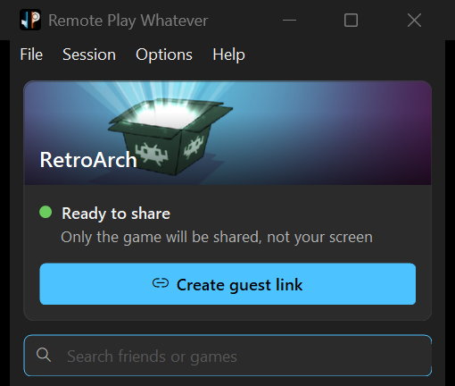

>[!NOTE]
> **About this fork.** This fork works with current Steam clients. **To install on Windows,** download `RemotePlayWhatever-win64.zip` from the [latest release](https://github.com/Casual-Gamer8001/RemotePlayWhatever/releases/latest), unzip it anywhere and run `RemotePlayWhatever.exe` (everything it needs is included). From then on it keeps itself up to date: when a new version is published here, it offers a one-click update. Every push is built by GitHub Actions.
>
> It is upstream RemotePlayWhatever plus:
> - the Steam-update fix from [pull request #289](https://github.com/m4dEngi/RemotePlayWhatever/pull/289) by @okabeeer: Steam's internal functions are looked up by name, so Steam updates don't break it, and invites create a real Remote Play Together group so guests can play, not just watch. **The fix only works in 64-bit builds** (`cmake -B build -A x64`).
> - non-Steam games (emulators and other shortcuts) are shown by name, and sharing stops by itself when the game closes, so guests don't keep seeing your desktop
> - a new look: the game you're sharing at the top of the main window with its picture from your Steam library, what guests will see, the guest link and session buttons, and short messages in the window (invite sent, link copied) instead of pop-ups; round avatars with status dots and an Invite button for each friend (clicking a friend's row no longer sends an invite by accident); and a guest controls window with a card per guest, keyboard / mouse / controller toggles with icons, and how long each guest has been there
> - End session (disconnect everyone, cancel unused invites and guest links, stop sharing), Copy guest link, and a Remove button for each guest
> - clickable guest links (Steam leaves out `https://`)
> - a separate control row for every guest, including Steam Link guests who join without a Steam account
> - a fresh Remote Play group check before every invite, and a question instead of a silent watch-only fallback when Steam won't create one
> - the game that will be shared, and who's connected, shown at the top of the main window; for a non-Steam game (which shares your whole screen) it asks once per session
> - an "Everyone" row and in-game hotkeys: Ctrl+Alt+K / M / C turn keyboard / mouse / controller on or off for everyone, Ctrl+Alt+D takes all control, Ctrl+Alt+G gives it back
> - a friend search box (it also finds what friends are playing), and one window at a time
> - friends who appear offline are listed too (greyed out, in an Offline group you can fold away), so you can still invite someone who's invisible; the invite link reaches them in Steam chat
> - what each online friend is doing, under their name: "Playing <game>" (named by Steam even if you don't have the game), Online, Away or Busy
> - "Played with recently" at the top of the friends list: up to 8 friends who've joined your sessions, most recent first
> - invites nobody has used yet are listed in the main window with a Cancel button each, so one friend's invite or a guest link can be withdrawn without ending the session
> - Ctrl+Alt+L copies a guest link from inside a game (it creates one if needed, for Steam games), with a notification instead of a window popping up
> - while your whole screen is shared (non-Steam games), Remote Play Whatever's own windows, including the guest link, are left out of the picture guests see (Windows 10 2004 or later)
> - a tray icon: minimizing hides the window by the clock, its right-click menu has the session buttons, and opening the app again brings the window back. "Start with Windows" in that menu opens it in the tray when you sign in (it waits for Steam to start)
> - short sounds when a guest joins or leaves (turn them off from the tray menu), and what each friend may use (keyboard, mouse, controller) is remembered for the next time they join
> - updates itself: it checks this fork's releases when it starts and every few hours, and when there's a newer version an "Update" button downloads it, checks it and restarts the app (not during a Remote Play session), with a line about what's new. The tray menu has "Check for updates" and a switch to turn the automatic checks off. If a Steam update ever stops it from starting, the message it shows looks for a fixed version and offers to install it
> - fixes: Steam calls are checked before they're made (so a Steam update can't make it call the wrong function; the one call Steam gives no name for is guarded too), clearer startup errors, and the control window no longer steals focus from a fullscreen game or keeps the app running after the main window is closed

# RemotePlayWhatever
Tiny application that lets you force remote play together any game you have in your steam library including non-steam ones.

<p align="center">
    
</p>

## How it works
RemotePlayWhatever communicates with your running Steam client and instructs it to initiate a Remote Play Together session for the currently running game launched through Steam. It does this by using undocumented and potentially **unstable** internal Steam client APIs.

>[!WARNING]
> - This tool relies on internal Steam client APIs. Future Steam client updates **may break compatibility** without warning.
> - This project aims to support the latest **stable** version of the Steam client. If you encounter issues after a Steam update, please check for a new version of RemotePlayWhatever or report an issue.
> - **Use at Your Own Risk:** This tool communicates locally with Steam via its standard IPC channel and doesn't modify files. However, it relies on unstable, internal APIs used by the Steam client itself, not the stable APIs meant for games. These internal APIs can change with Steam updates, potentially breaking this tool without warning.

## Getting Started
Download the latest [release](https://github.com/Casual-Gamer8001/RemotePlayWhatever/releases/latest) of this fork:
- Windows:
    - Download `RemotePlayWhatever-win64.zip`, extract it somewhere and run `RemotePlayWhatever.exe`; no installation required.
- Linux:
    - This fork doesn't publish Linux packages, so [build it from source](#building-from-source). The existing Linux packages (the Arch AUR package, and the *.deb and AppImage on the original project's releases page) are the original 0.2.14 version, which doesn't work with current Steam clients.

... or [build the app from source](#building-from-source)

## Usage
1. Ensure the Steam client is running.
2. Launch RemotePlayWhatever.
3. Launch the game you want to play *through the Steam client*.
4. Alt+Tab (or switch) back to the RemotePlayWhatever window.
5. Invite your friend(s):
    - **Direct Invite:** Click **Invite** next to a friend. They will receive the invite link via a Steam Chat message.
    - **Guest Link:** Click **Create guest link**. The link is copied to your clipboard, ready for you to paste and share manually (**Copy guest link** copies it again).
6. Alt+Tab (or switch) back to your game.

## Command line arguments
```
-a, --appid=<num>  	AppID to use for non-steam games (Default is 480)
-i, --invite=<str> 	Send remote play invites to provided comma separated 
                        SteamID64s list ( use 0 for guest link ) 
-g, --guestid=<num>	Guest client id
-c, --cancel=<str> 	Cancel invite for provided SteamID64 and GuestID
```

## Building from source
### Linux ( Debian )
1. Install the dependencies:
    ```bash
    sudo apt update
    sudo apt install build-essential git cmake libwxgtk3.2-dev
    ```
2. Clone the repository:
    ```bash
    git clone --recurse-submodules https://github.com/Casual-Gamer8001/RemotePlayWhatever.git
    cd RemotePlayWhatever
    ```
3. Configure and build:
    ```bash
    cmake -B build -DCMAKE_BUILD_TYPE=Release
    cmake --build build
    ```
    The executable will be placed in the `build/RemotePlayWhatever` directory.
4. **( optional )** Create and install deb package:
    ```bash
    cmake --build build --target package
    sudo dpkg -i build/RemotePlayWhatever-*-Linux.deb
    ```

### Windows
These instructions assume a 64-bit build using Visual Studio (the Steam-update fix only works in 64-bit builds). \
All commands should be executed in a `Developer Command Prompt for VS`.

1. Download and install [Visual Studio](https://visualstudio.microsoft.com/) (Community Edition is free) with the "Desktop development with C++" workload installed and "Git For Windows" and "MSVC v142 - VS 2019 C++ x64/x86 build tools" components.
2. Download and install [wxWidgets](https://wxwidgets.org/) ( follow the docs; you need its 64-bit libraries ).
3. Clone the repository:
    ```bash
    git clone --recurse-submodules https://github.com/Casual-Gamer8001/RemotePlayWhatever.git && 
    cd RemotePlayWhatever
    ```
4. Configure and build:
    ```bash
    cmake -B build -A x64
    cmake --build build --config Release
    ```
    If build is successful, the executable will be created in the `build\RemotePlayWhatever\Release` folder.

## Contributing
Contributions are welcome! If you find a bug or have a feature request, please open an issue.

## Acknowledgements
- Original idea and initial testing by @Jondycz

## Alternatives
Steam
- [RemotePlayDetached](https://github.com/smaTc/RemotePlayDetached)
- [cooplauncher](https://github.com/MBaliver/cooplauncher)

Standalone
- [Parsec](https://parsec.app/)

